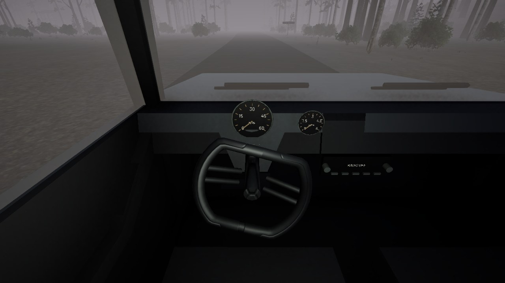
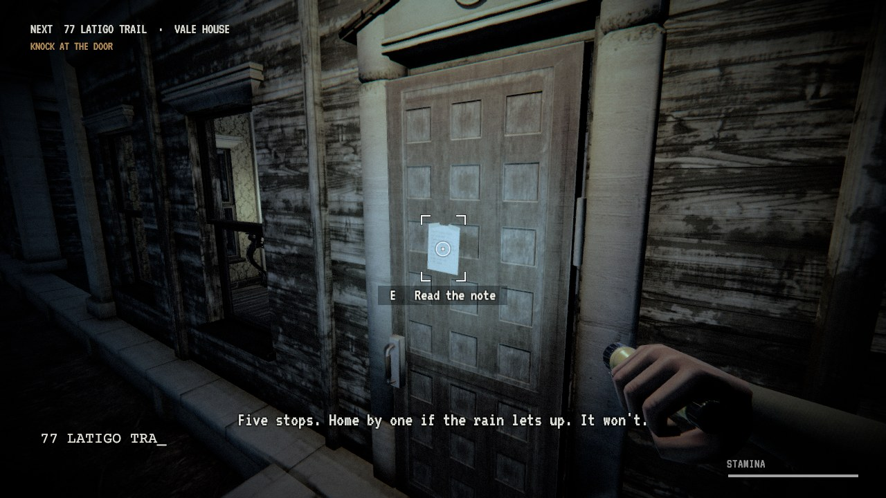
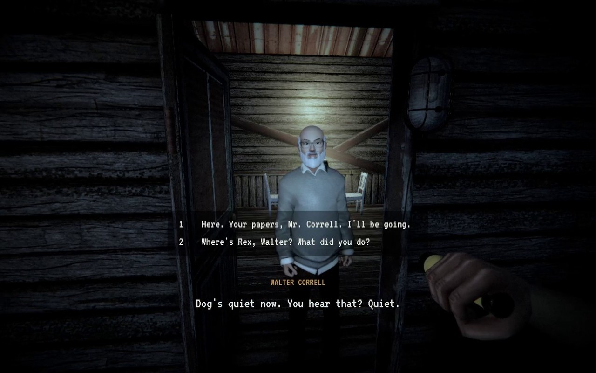
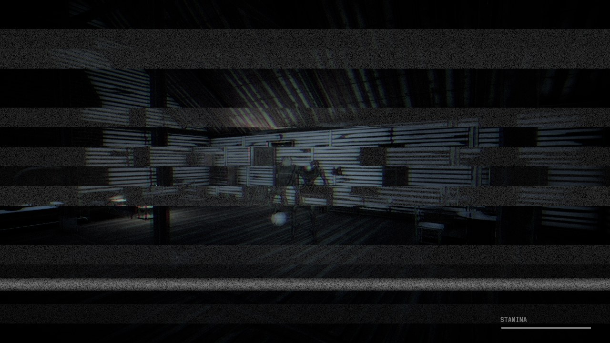

# Service

> An atmospheric first-person horror game about serving civil process documents across rural Hollis County after dark.
>
> **Development Status**: Active development - currently working on Version 29.

[](https://unity.com/)
[-yellow?style=flat-square)](https://github.com/Amirtheshwaran/service)
[](https://unity.com/)
[](LICENSE)



## Overview

Set in October 1998, you play as a civil process server tasked with delivering court notices to isolated properties throughout rural Hollis County. Navigate dark two-lane county roads, inspect handwritten doorstep notes under flashlight beam, and explore sparsely lit rural residences to locate recipients.

There is no combat. Survival depends on keen observation, composure, and knowing when a delivery is no longer safe to complete.

## Highlights

- **Free-Roam Driving and Foot Exploration**: Drive a 1990s county vehicle along winding rural routes with manual ignition, headlights, radio tuning, and on-foot transitions.
- **Three-Night Narrative Campaign**: Work multi-shift delivery dockets across five rural parcels and an unsurveyed route, featuring branching dialogue and alternate outcomes.
- **Custom VHS and Camcorder Visuals**: Authentic analog post-processing with adjustable tape degradation, edge fringing, and dynamic gamma-space color grading built on Unity URP.
- **Tension and Pursuit Mechanics**: Encounter logic with stamina-limited sprint escapes, composure-based horror encounters, and proximity dread audio.
- **First-Person Hands and Gestures**: Dedicated animations for vehicle steering, knocking, handing over papers, placing notices, flashlight grip, and door interactions.
- **Spatial Audio and Foley**: Authentic field recordings, Great Horned Owl canopy calls, dry leaves footsteps, and distance-attenuated environmental acoustics.
- **Automated Regression Suite**: In-engine smoke test suite verifying route dockets, collision bounds, prop placement, and lighting sanity.

## Gameplay Gallery

| Doorstep Delivery | Resident Interaction |
| :---: | :---: |
|  |  |
| *Inspecting handwritten doorstep notices with torch auto-exposure* | *Conversational doorstep delivery with dynamic dialogue choices* |

| Atmospheric Encounter | Cockpit Navigation |
| :---: | :---: |
|  |  |
| *High-tension encounter where composure determines survival* | *Nighttime navigation along unlit rural corridors in Hollis County* |

## Controls

| Key | Action |
| --- | --- |
| **WASD** | Walk / Drive (S reverses vehicle) |
| **Mouse** | Look around (including cockpit view) |
| **E / Space / Click** | Interact / knock / enter or exit car / advance dialogue |
| **R** | Leave documents on marked delivery table |
| **U** | Mark property as unable to serve |
| **F** | Toggle flashlight (on foot) |
| **Space** | Jump (on foot) / turn ignition key (in car) |
| **Ctrl** | Hold to crouch (on foot) |
| **Shift** | Forward sprint (stamina limited) / vehicle brake |
| **Tab** | Open docket clipboard (in car, stopped) |
| **V / B** | Toggle radio / cycle radio stations (in car) |
| **Esc** | Pause menu / close inspected documents |

## Technical Details

- **Engine and Pipeline**: Built in Unity 6 (6000.6.0f1) utilizing the Universal Render Pipeline (URP).
- **Large Asset Management**: Version-controlled using Git LFS for large level scenes (`HollisCounty.unity`).
- **Post-Processing**: Custom shader passes implementing retro camcorder dithering, vignette, scanlines, and adaptive torch exposure.
- **Verification**: Built-in automated headless test framework covering player movement, route triggers, door interactions, and placement audits.

## Running the Project

1. Install **Unity 6 (6000.6.0f1)** via Unity Hub.
2. Clone this repository (ensure Git LFS is installed and run `git lfs pull` to fetch scene assets):
   ```bash
   git clone https://github.com/Amirtheshwaran/service.git
   cd service/ServiceProject
   git lfs pull
   ```
3. Open the `ServiceProject` directory in Unity Hub.
4. In the Project tab, open `Assets/Scenes/HollisCounty.unity`.
5. Press **Play**.

## License and Credits

- **Original Project Code and Design**: All Rights Reserved for personal portfolio and educational evaluation. See [LICENSE](LICENSE) for details.
- **Third-Party Assets**: Audio recordings, 3D models, textures, and fonts are used under CC0, CC BY, SIL Open Font License, or standard commercial licenses. Full links and attributions are documented in [ASSET-CREDITS.txt](ASSET-CREDITS.txt).
